<div align="center">



<br/>

[](https://www.linkedin.com/in/pablo-nicolas-marin)
[](https://www.instagram.com/pablit0_clavito__/)
[](mailto:pnicolasmarin2007@gmail.com)

</div>

## `> cat about.md`

```yaml
name:      Pablo Nicolás Marín
studying:  Systems Engineering @ Universidad del Valle (Colombia)
community: AWS Student Builder Group @ Univalle
building:  serverless apps on AWS, Linux tooling, algorithms
into:      math, logic, cybersecurity, a little bit of quantum
learning:  Go
daily:     Omarchy · Hyprland · Neovim · tmux
```

## `> ls ~/projects --featured`

<table>
<tr>
<td width="50%" valign="top">

### 💈 [Shaggy Barber](https://d2ficupb35lp6p.cloudfront.net)

Production booking platform for a real barbershop. Serverless on AWS with infrastructure as code: online booking with **no double booking**, WhatsApp notices and reminders, passwordless customer accounts and an admin panel with MFA, live agenda and stats.

`Astro` `TypeScript` `Tailwind` `Lambda` `DynamoDB` `API Gateway` `Cognito` `EventBridge` `CDK` `GitHub Actions`

</td>
<td width="50%" valign="top">

### 🩺 [Dr. Cloud](https://github.com/Slylem0/AWS-Weekend-challenge)

First aid for AWS errors. Paste the error and an AI agent answers with a diagnosis, a step-by-step prescription and a check-up. Least-privilege by design; never suggests `"Action": "*"`.

`Amazon Bedrock` `Strands Agents` `Streamlit` `App Runner` `ECR` `IAM`

</td>
</tr>
<tr>
<td width="50%" valign="top">

### 🖥️ [Display Switch for Omarchy](https://github.com/Slylem0/omarchy-display-switch)

<kbd>Win</kbd>+<kbd>P</kbd> for Hyprland: PC only, duplicate, extend or second
screen only. Rotation, scale and brightness remembered **per display** (by EDID), not per port.

`QML` `Shell` `JavaScript` `Hyprland`

</td>
<td width="50%" valign="top">

### 🎲 [Quantum Dice](https://github.com/Slylem0/quantum_dice)

Randomness certified by physics: measure a Bell (CHSH) violation on IonQ and turn it into a bound on unpredictability, then extract the bits with Toeplitz hashing. Built for the Qollab × IonQ hackathon 2026.

`Python` `Qiskit` `IonQ` `JavaScript`

</td>
</tr>
<tr>
<td width="50%" valign="top">

### 🤖 [AWS Daily Topic Agent](https://github.com/Slylem0/aws-daily-topic-agent)

Autonomous agent that publishes a bilingual AWS Cloud Practitioner topic every morning for my university's Builder Group. Zero human input.

`EventBridge Scheduler` `Lambda` `Bedrock (Nova)` `S3`

</td>
<td width="50%" valign="top">

### 🧮 [Compressed-range query engine](https://github.com/Slylem0/ADA_final_project)

Answers queries and updates over huge sequences stored as compressed ranges, without ever expanding them. Algorithm analysis final project.

`C++` `Algorithms` `Data structures`

</td>
</tr>
</table>

## `> which --all tools`

<p align="center">
  
  <br/>
  
</p>

## `> git log --stat`

<p align="center">
  
  
  <br/>
  
</p>

<picture>
  <source media="(prefers-color-scheme: dark)" srcset="https://raw.githubusercontent.com/Slylem0/Slylem0/output/github-snake-dark.svg" />
  <source media="(prefers-color-scheme: light)" srcset="https://raw.githubusercontent.com/Slylem0/Slylem0/output/github-snake.svg" />
  
</picture>

<p align="center"><sub><code>while (alive) { coffee++; code(); }</code></sub></p>
