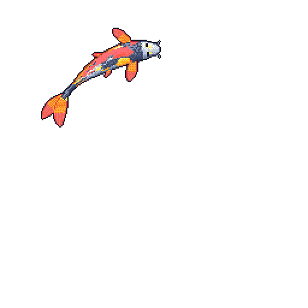

<div align="center">


<br/>

[](https://main.dx1vkp1smlyu7.amplifyapp.com)
[](https://www.linkedin.com/in/pablo-nicolas-marin)
[](mailto:pnicolasmarin2007@gmail.com)
[](https://www.instagram.com/pablit0_clavito__/)

</div>

## `$ cat about.yaml`

```yaml
name:      Pablo Nicolás Marín
location:  Buga, Colombia
studying:  Systems Engineering, Universidad del Valle
certified: AWS Certified Cloud Practitioner
community: AWS Student Builder Group Univalle (Partnerships & Academy Lead)
focus:     serverless backends on AWS, AI agents on Amazon Bedrock, Linux tooling
into:      math, logic, algorithms, cybersecurity, a little bit of quantum
next:      AWS Certified AI Practitioner
```

## `$ ls ~/projects --sort=recent`

| Project | What it does | Stack |
|---|---|---|
| **[SEE YOU SPACE BUILDER](https://github.com/Slylem0/portafolio)**<br/><sub>[live](https://main.dx1vkp1smlyu7.amplifyapp.com)</sub> | My portfolio for the AWS Student Builder Challenge. A secret Hyprland-style desktop with a working terminal, and TRIAD: three AI cores on Amazon Bedrock that vote on any question. | `Astro` `React` `Amplify` `Lambda` `Bedrock` `DynamoDB` |
| **[Shaggy Barber](https://d2ficupb35lp6p.cloudfront.net)**<br/><sub>live</sub> | Booking platform for a real barbershop: no double booking, WhatsApp reminders, passwordless accounts and an admin panel with MFA. | `Astro` `TypeScript` `CDK` `Lambda` `DynamoDB` `Cognito` `EventBridge` |
| **[Grandma's Bouncer](https://github.com/Slylem0/grandmas-bouncer)**<br/><sub>[demo](https://youtu.be/OS2RwfqWgh8)</sub> | A guardrail that stops scam emails from hijacking an AI assistant that pays a 72-year-old's bills. | `Strands Agents` `Decider 2B` `Bedrock` |
| **[Dr. Cloud](https://github.com/Slylem0/AWS-Weekend-challenge)** | First aid for AWS errors: paste an error, get a diagnosis, a step-by-step fix and a check-up. Least privilege by design. | `Bedrock` `Strands` `Streamlit` `App Runner` |
| **[AWS Daily Topic Agent](https://github.com/Slylem0/aws-daily-topic-agent)** | Publishes a bilingual AWS Cloud Practitioner topic every morning for my university's Builder Group, with no human input. | `EventBridge Scheduler` `Lambda` `Bedrock` `S3` |
| **[Omarchy Display Switch](https://github.com/Slylem0/omarchy-display-switch)**<br/><sub>11 stars</sub> | <kbd>Win</kbd>+<kbd>P</kbd> for Hyprland: PC only, duplicate, extend or second screen only, with rotation and scale remembered per display. | `QML` `Shell` `Hyprland` |
| **[Quantum Dice](https://github.com/Slylem0/quantum_dice)** | Randomness certified by physics: a Bell (CHSH) violation measured on IonQ, turned into certified random bits. Qollab × IonQ hackathon 2026. | `Python` `Qiskit` `IonQ` |
| **[Compressed-range query engine](https://github.com/Slylem0/ADA_final_project)** | Queries and updates over huge sequences stored as compressed ranges, without ever expanding them. | `C++` `Algorithms` |

## `$ which --all tools`

<p align="center">
  
  <br/>
  
</p>

## `$ git koi`

<p align="center">
  
  <br/>
  <sub>Redrawn every night from my public activity by <a href="https://github.com/yalongwastaken/git-koi">git-koi</a>.</sub>
</p>
