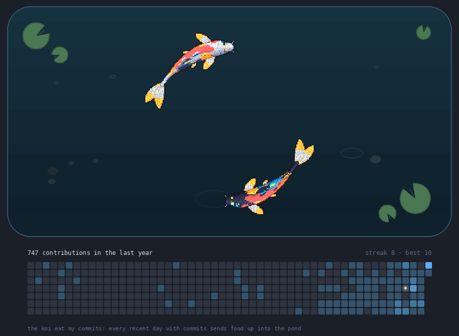

<div align="center">


<br/>

[](https://main.dx1vkp1smlyu7.amplifyapp.com)
[](https://www.linkedin.com/in/pablo-nicolas-marin)
[](mailto:pnicolasmarin2007@gmail.com)
[](https://www.instagram.com/pablit0_clavito__/)

</div>

## `$ cat about.yaml`

```yaml
name:      Pablo Nicolás Marín
location:  Buga, Colombia
studying:  Systems Engineering, Universidad del Valle
certified: AWS Certified Cloud Practitioner
community: AWS Student Builder Group Univalle (Partnerships & Academy Lead)
focus:     serverless backends on AWS, AI agents on Amazon Bedrock, Linux tooling
into:      math, logic, algorithms, cybersecurity, a little bit of quantum
next:      AWS Certified AI Practitioner
```

## `$ ls ~/projects --featured`

<table>
<tr>
<td width="50%" valign="top">

**[SEE YOU SPACE BUILDER](https://github.com/Slylem0/portafolio)** · [live](https://main.dx1vkp1smlyu7.amplifyapp.com)

My portfolio: a secret Hyprland-style desktop with a working terminal, and three AI cores on Amazon Bedrock that vote on any question.

`Astro` `Amplify` `Lambda` `Bedrock` `DynamoDB`

</td>
<td width="50%" valign="top">

**[Shaggy Barber](https://d2ficupb35lp6p.cloudfront.net)** · live

Booking platform for a real barbershop: no double booking, WhatsApp reminders, passwordless accounts and an admin panel with MFA.

`TypeScript` `CDK` `Lambda` `DynamoDB` `Cognito`

</td>
</tr>
<tr>
<td width="50%" valign="top">

**[Grandma's Bouncer](https://github.com/Slylem0/grandmas-bouncer)** · [demo](https://youtu.be/OS2RwfqWgh8)

A guardrail that stops scam emails from hijacking an AI assistant that pays a 72-year-old's bills.

`Strands Agents` `Decider 2B` `Bedrock`

</td>
<td width="50%" valign="top">

**[Omarchy Display Switch](https://github.com/Slylem0/omarchy-display-switch)** · 11 stars

<kbd>Win</kbd>+<kbd>P</kbd> for Hyprland: duplicate, extend or second screen only, with scale and rotation remembered per display.

`QML` `Shell` `Hyprland`

</td>
</tr>
</table>

<sub>More: [Dr. Cloud](https://github.com/Slylem0/AWS-Weekend-challenge) (AWS error triage agent) · [AWS Daily Topic Agent](https://github.com/Slylem0/aws-daily-topic-agent) (autonomous study posts) · [Quantum Dice](https://github.com/Slylem0/quantum_dice) (certified quantum randomness) · [Compressed-range engine](https://github.com/Slylem0/ADA_final_project) (C++ algorithms)</sub>

## `$ which --all tools`

<p align="center">
  
  <br/>
  
</p>

## `$ git koi --pond`

<p align="center">
  
  <br/>
  <sub>Koi drawn every night from my public activity by <a href="https://github.com/yalongwastaken/git-koi">git-koi</a>; the pond, the food and the Pisces pair are mine.</sub>
</p>
